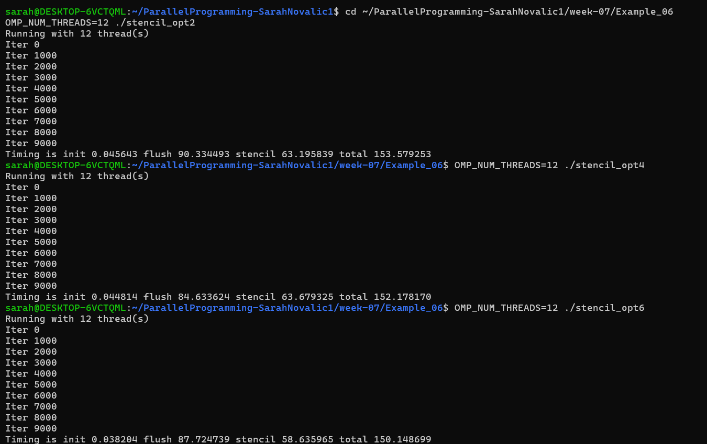

# Lab 07 - OpenMP That Performs

## 1. Introduction

In this lab, I tested three stencil programs:

- `stencil_opt2`
- `stencil_opt4`
- `stencil_opt6`

I used 12 threads and 10,000 iterations for each program.

The goal was to compare their speed and see how they work.

## 2. Computer Information

- CPU threads: 12
- Threads used: 12
- Compiler: GCC
- OpenMP: Yes
- Optimization: -O2

## 3. Differences Between the Programs

**stencil_opt2**

This is the first version. It uses many separate parallel regions. Each parallel loop has a barrier at the end. Threads must wait for each other before they continue.

**stencil_opt4**

This version uses one big parallel region. Threads stay in the same region while doing the work. It also uses `nowait` to remove waiting after the flush loop. This can save time.

**stencil_opt6**

This version also uses one big parallel region. It divides the rows between threads by using thread IDs. It uses barriers to make sure that all threads finish their work before the next step.

## 4. Results

I ran all three programs with 12 threads and 10,000 iterations.

| Time | stencil_opt2 | stencil_opt4 | stencil_opt6 |
|---|---:|---:|---:|
| Initialization | 0.045643 s | 0.044814 s | 0.038204 s |
| Flush | 90.334493 s | 84.633624 s | 87.724739 s |
| Stencil | 63.195839 s | 63.679325 s | 58.635965 s |
| **Total** | **153.579253 s** | **152.178170 s** | **150.148699 s** |

The same results are also saved in `results.txt`.

## 5. Results Explanation

The fastest program was `stencil_opt6`. Its total time was 150.148699 seconds.

The slowest program was `stencil_opt2`.

The results show that the third program was the fastest in my test. The times are close, but `stencil_opt6` had the best result.

## 6. Questions

### 1. How many threads did your CPU use?

My computer used 12 threads to run the programs.

### 2. What parts of the code were improved? What strategies were used?

The main improvements were in memory use, work sharing and waiting between threads.

The programs use these methods:

- Parallel work: threads share the work.
- One parallel region: threads do not need to start a new region many times.
- `nowait`: threads do not have to wait after the flush loop.
- Manual row sharing: in `stencil_opt6`, each thread works on its own rows.
- Barriers: threads wait when they need to finish a step together.

### 3. What is the difference between explicit and implicit barriers?

An implicit barrier is added by OpenMP automatically. For example, it is used at the end of a normal `omp for` loop. All threads must finish before they continue.

An explicit barrier is added by the programmer with this line:

`#pragma omp barrier`

It also makes all threads wait at the same point.

In these programs:

- `stencil_opt2` uses implicit barriers.
- `stencil_opt4` uses `nowait`, an implicit barrier at the end of the stencil loop, and an explicit barrier.
- `stencil_opt6` uses explicit barriers.

Barriers help the program work correctly, but too many barriers can slow it down.

## 7. Screenshot

The screenshot below shows the terminal after running all three programs.

